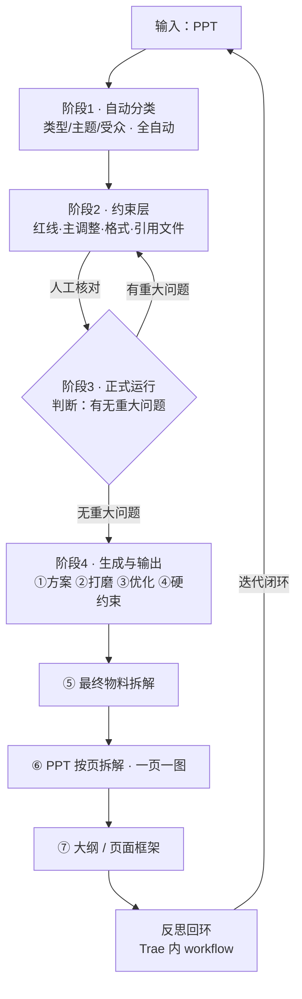

# AI-PPT 生成工作流 · 手稿整理稿（v4 · 补回⑤⑥⑦ + 工具链修正）

> 用途：把手绘工作流收拾干净，作为 Claude Code 生成「一套完整 Prompt 套件」的输入底稿。
> 修正依据：用户 2026-10-22 口头澄清（工具链 Trae/Cloud Code / 阶段1自动分类 / 阶段2约束层+四类约束+人工核对 / 阶段3正式运行判断重大问题 / 阶段4生成输出 / 最后的 workflow 也走 Trae）。
> 状态：阶段结构、四类约束、⑤⑥⑦、工具链均已落实。

---

## 0. 工具链与运行端（必读 · 给 Cloud Code 的上下文）

- **ArchitectureOS** = 用户已在 **Trae** 上做好的一个 prompt（设计工作流的总纲 / 三基石：边界·等级·门控）。
- 本工作流（AI-PPT 生成）由 **Cloud Code 据此底稿生成一套完整 Prompt 套件**（主控 + 分阶段子 prompt + 变量 + 门控话术 + 异常处理）。
- 生成后的 Prompt 套件 **在 Trae 上作为运行端执行**（与 ArchitectureOS 同一载体）。
- 本工作流最后的「反思 / 迭代 workflow」**同样在 Trae 上使用**（不是扣子空间），即整条链路都在 Trae 运行端闭环。
- 即：**手稿 →（本底稿）→ Cloud Code 生成 Prompt 套件 → Trae 运行端落地（含最后的 workflow 回环）**。

---

## 1. 原稿识读（忠实转录 · 重构后）

- **输入**：PPT
- **阶段1 · 自动分类**：对输入 PPT 自动归类（类型 / 主题 / 受众），**全自动，不进人工**
- **阶段2 · 约束层**（需**人工核对**）：定义四类约束 + 人把关
  - **红线（不可碰）**：原文数据、排版 / 版式 —— 绝对不能改
  - **主调整**：主要的调整内容约束（允许改什么、改到什么程度）
  - **格式**：排版逻辑约束（版面 / 字体 / 层级等逻辑）
  - **引用文件**：PPT 内若引用规范 / 标准等，需联网核对版本有效性
  - 人工核对目的：确认校对字写对没、指标算错没（人把最后一道关）
- **阶段3 · 正式运行**（全自动）：按约束层执行生成；运行中**判断是否存在「重大问题」**
  - 无重大问题 → 进入阶段4
  - 有重大问题 → 回约束层重新处理（不放行）
- **阶段4 · 生成与输出**（人机协作）：
  - ① 生成 2–3 个方案
  - ② 选定后针对用户需求反复打磨
  - ③ 评估与优化
  - ④ 硬约束贯穿（一页一图表 / 图·表·内容严格对应）
  - ⑤ **最终物料拆解**：把确定的方案拆成可交付的物料清单（页面 / 图表 / 文案块等）
  - ⑥ **PPT 按页拆解**：逐页落实内容，一页一图，图·文·表严格对应
  - ⑦ **生成大纲 / 页面框架**：输出整册大纲 + 每页框架（标题 / 核心图表 / 要点）
- **反思回环**：结果回灌 Trae 上的 workflow，形成迭代闭环（**在 Trae 内完成**）

> 说明：原稿"重大问题"两处含义在此统一——它是阶段3运行时的**判断闸门**（有无重大偏差），而阶段2约束层产出的"约束清单/标准表"即此前说的"md 文件"。此前含糊的"括号两项"已被本版四类约束取代。
> 注：⑤⑥⑦ 三项用户原话"步骤差不多"（均为把方案拆成具体输出物的动作）。下列动作描述为本稿基于原图的最佳识别，若原稿有更精确原文请告知，我替换即可。

---

## 2. 整理后的流程（分阶段 · 可直接喂给 Claude Code）

### 阶段1 · 自动分类（全自动）
- 输入：一份 PPT
- 动作：自动归类（内容类型 / 主题 / 受众 / 风格基调）
- 输出：分类结论
- 人工：无（全自动）

### 阶段2 · 约束层（人工核对 · 强制）
- 动作：产出约束清单（即标准表 md），含四类约束
  1. 红线：原文数据 + 排版版式，不可碰
  2. 主调整：主要调整内容约束
  3. 格式：排版逻辑约束
  4. 引用文件：引用规范 / 标准须联网核版本
- 人工：必须由人核对（校对错字、指标计算正确性）
- 输出：经人确认的约束清单

### 阶段3 · 正式运行（全自动 · 带闸门）
- 动作：按约束清单执行生成
- 判断：**有无重大问题**（违背红线 / 主调整 / 格式 / 引用等）
  - 无 → 进阶段4
  - 有 → 回阶段2 重新处理（不放行）

### 阶段4 · 生成与输出（人机协作）
- ① 生成 2–3 方案；② 选定打磨；③ 评估优化
- ④ 硬约束贯穿（一页一图表 / 图表内容对应）
- ⑤ **最终物料拆解**：把选定方案拆成可交付物料清单（页面块 / 图表清单 / 文案块）
- ⑥ **PPT 按页拆解**：逐页落实，每页一个核心图表，图·文·表严格对应
- ⑦ **生成大纲 / 页面框架**：整册大纲 + 每页框架（标题 / 核心图表 / 要点）
- 人工：方案选定、最终生成前确认

### 回环 · 反思
- 结果回灌 **Trae 上的 workflow**（非扣子空间），迭代闭环

---

## 3. 关键约束（必须写进 prompt）

- **红线（禁改）**：原文数据、排版版式
- **主调整**：主要调整内容约束
- **格式**：排版逻辑约束（一页一图表、图/表/内容对应、结论先行）
- **引用文件**：引用规范 / 标准须联网核版本
- **重大问题闸门**：阶段3 一旦发现重大偏差，禁止放行、回约束层
- **⑤物料拆解** / **⑥按页一图** / **⑦大纲框架**：阶段4 三类输出形态，均须满足"图·文·表严格对应"
- 人工节点：约束层核对、方案选定、最终生成前

---

## 4. 人机协作节点（门控）

| 节点 | 谁做 | 说明 |
|---|---|---|
| 阶段1 分类 | AI（自动） | 不进人工 |
| 阶段2 约束层核对 | **人（强制）** | 校对错字 / 指标正确性，人把最后关 |
| 阶段3 重大问题判断 | AI（自动） | 有重大问题 → 自动回约束层，不放行 |
| 阶段4 方案选定 | 人 | 2–3 方案中选 |
| 阶段4 ⑤⑥⑦ 输出前 | 人 | 确认物料 / 逐页 / 大纲后才出 PPT |

---

## 5. 工具与产物

- **Cloud Code**：依据本底稿生成 Prompt 套件
- **Trae**：运行端（同 ArchitectureOS 载体），执行生成的 Prompt；**最后的反思 / 迭代 workflow 也在 Trae 内运行**
- 产物：约束清单 md → PPT 大纲 / 页面框架 → 最终 PPT（经 ⑤物料拆解 / ⑥按页一图 / ⑦大纲）

---

## 6. 给 Cloud Code 的元指令（可直接粘贴）

> 请基于以上工作流与工具链（Cloud Code 生成 → Trae 运行，含最后的 Trae workflow 回环），产出：
> 1. 一个主控 system prompt（角色、目标、全局约束、人机节点、Trae 运行约定）
> 2. 分阶段子 prompt（阶段1–4，各含输入 / 输出 / 检查项 / 全自动 or 人工）
> 3. 变量占位符清单（如 `{{PPT路径}}`、`{{分类}}`、`{{页数}}`）
> 4. 人工确认节点的触发条件与话术（重点：阶段2 约束层必须显式请求人工核对；阶段3 重大问题须触发回退）
> 5. 输出格式约束（约束清单 md 结构 + pptx 页面框架 + ⑤物料清单 / ⑥逐页 / ⑦大纲 三种形态）
> 6. 异常处理：信息不足时追问；无法确认时明确说"无法确认"，允许暂停 / 承认无法完成

---

## 7. 已落实的修正清单

- [x] 工具链标注：ArchitectureOS = Trae 上的 prompt；Cloud Code 生成 → Trae 运行
- [x] 阶段1 改为「自动分类」（全自动，去掉人工确认）
- [x] 阶段2 改为「约束层」非初稿；拆出红线 / 主调整 / 格式 / 引用文件四类
- [x] 阶段2 标为「人工核对」（校对错字 / 指标正确性）
- [x] 阶段3 改为「正式运行」带重大问题闸门（无→阶段4，有→回约束层）
- [x] 阶段4 = 生成与输出（方案迭代 + ⑤⑥⑦ + 大纲）
- [x] 原"括号两项 / md 文件"困惑，由四类约束取代并厘清
- [x] **补回第⑤⑥⑦步**：⑤最终物料拆解 / ⑥PPT按页拆解（一页一图）/ ⑦生成大纲页面框架，独立成步并展开
- [x] **工具链修正**：最后的反思 / 迭代 workflow 也是 Trae 内使用（原误写"扣子空间"，已改正）

---

## 8. 流程图（Mermaid，可直接贴给 Claude Code）

